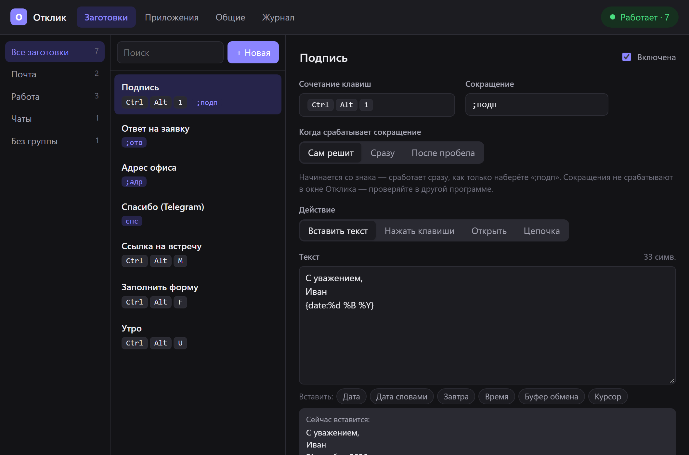
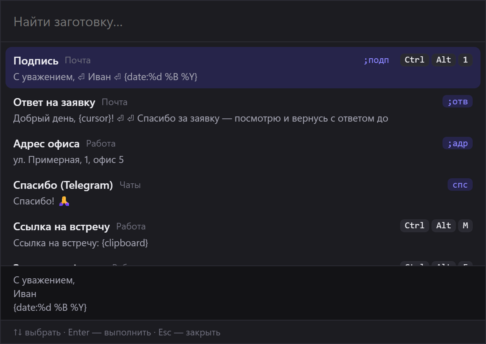

<p align="center">
  
</p>

<h1 align="center">Отклик</h1>

<p align="center">
  Горячие клавиши и заготовки текста для Windows.<br>
  Нажал сочетание или набрал сокращение — в любом окне появился нужный текст,<br>
  нажались клавиши или открылась программа.
</p>

<p align="center">
  <a href="../../releases/latest">Скачать</a> ·
  <a href="docs/ARCHITECTURE.md">Как устроено</a> ·
  <a href="#разработка">Разработка</a>
</p>



---

## Что умеет

**Сочетание → действие.** `Ctrl+Alt+1` вставляет подпись, `Ctrl+Alt+F` заполняет
форму, `Ctrl+Alt+U` открывает рабочие сайты. Сочетание записывается в окне —
нажали клавиши, и готово.

**Сокращения.** Набрали `;адр` — вместо него встал адрес. Сокращение со знаком
срабатывает сразу, обычное слово (`спс`) — после пробела и только целым словом.
Раскладка не важна: `;адр` распознаётся и в русской.

**Подстановки в тексте.**

| Токен | Что вставится |
|---|---|
| `{date}` · `{дата}` | 21.10.2026 |
| `{date:%d %B %Y}` | 21 октября 2026 — месяц и день недели по-русски |
| `{date+1d}`, `{date-1w}`, `{date+1m}` | дата со сдвигом |
| `{time}` | 14:05 |
| `{clipboard}` · `{буфер}` | то, что сейчас скопировано |
| `{cursor}` · `{курсор}` | здесь окажется курсор после вставки |

**Цепочки клавиш.** `Иванов{Tab}Иван{Tab 2}{wait 200}{Ctrl+Enter}` — текст,
нажатия, повторы и паузы. Опечатка в имени клавиши видна сразу, а не печатается.

**Открыть.** Сайт, папку, файл или программу с аргументами — как через Win+R.

**Цепочки шагов.** «Открыть трекер → подождать → нажать `Ctrl+L`» — одним сочетанием.

**Правила по приложениям.** Одно и то же сочетание в Telegram делает одно,
в Outlook — другое, а в остальных программах работает как обычно.

**Всплывающий поиск.** `Ctrl+Alt+Space` в любой программе — окошко у курсора,
нечёткий поиск по названию, сокращению и тексту, Enter — и заготовка
выполняется там, откуда вызвали.

<p align="center">
  
</p>

## Бережно к вам

- **Буфер обмена возвращается как был** — с картинками и файлами — и не
  засоряет журнал Win+V.
- **Не печатает не туда.** Если вы переключились в другое окно, пока
  заготовка готовилась, — действие отменяется.
- **Набранный текст никуда не пишется.** Для сокращений программа помнит
  последние символы только в памяти.
- **Работает без интернета** и без учётной записи. Всё хранится в одном
  файле на вашем компьютере.

## Установка

1. Скачайте `Otklik_…_x64-setup.exe` со страницы [выпусков](../../releases/latest)
   и запустите. Ставится для текущего пользователя, права администратора не нужны.
2. В трее появится значок **О**. Щелчок — окно настроек.
3. Запуск вместе с Windows — «Общие → Запускать вместе с Windows»
   (или ярлык в папке автозагрузки — что-то одно).

Чтобы сочетания работали и в окнах, запущенных от администратора (диспетчер
задач, установщики), — «Общие → Права администратора».

Переезжаете с Espanso? «Общие → Импорт из Espanso» перенесёт заготовки.

## Настройки

Всё, что есть в окне, хранится в одном файле —
`%APPDATA%\app.otklik.desktop\config.yaml`. Его можно править и руками:
изменения подхватываются сразу, а ошибка в файле не ломает работу —
программа покажет строку и останется на прошлой версии.

```yaml
settings:
  pause_hotkey: Ctrl+Alt+Pause
  search_hotkey: Ctrl+Alt+Space

apps:
  telegram: { exe: Telegram.exe }

snippets:
  - name: Подпись
    hotkey: Ctrl+Alt+1
    abbr: ";подп"
    text: |
      С уважением,
      Иван
      {date:%d %B %Y}

  - name: Спасибо
    abbr: спс
    only_in: telegram
    text: "Спасибо! 🙏"

  - name: Утро
    hotkey: Ctrl+Alt+U
    steps:
      - open: https://tracker.yandex.ru
      - wait: 1500
      - keys: "{Ctrl+L}"
```

Перед каждым сохранением из окна рядом остаётся копия (последние 20).

## Разработка

Tauri 2 (Rust) + React 19 + Vite. Перехват клавиатуры, вставка и буфер
обмена — на WinAPI (`windows-sys`). Как всё устроено и почему —
[docs/ARCHITECTURE.md](docs/ARCHITECTURE.md).

```bash
npm install
npm run dev          # программа в режиме разработки
npm run dev:web      # только окно в браузере, на демо-данных
npm run build        # установщик → D:\dev\cargo-target\release\bundle\nsis\
```

Общая папка сборки Rust — `D:\dev\cargo-target` (переменная `CARGO_TARGET_DIR`).

### Проверки

```bash
npm run test:rust    # юнит-тесты ядра: сочетания, правила, подстановки, сокращения
npm run lint:rust    # clippy, предупреждения — ошибки
npm run typecheck    # TypeScript
npm run smoke        # сквозной тест в настоящей Windows
```

`smoke` сам нажимает сочетания в своём окошке и проверяет результат: вставку
печатью и через буфер, возврат буфера, подстановки, клавиши, цепочки,
сокращения, поиск. На время проверки дописывает в `config.yaml` свои правила
и потом возвращает файл как был. Клавиши посылает, только если в фокусе его
окно; при первой потере фокуса останавливается — во время теста не трогайте
клавиатуру и мышь.

## Ограничения

- Внутри окна самого Отклика сочетания и сокращения не срабатывают — так
  устроена Windows.
- Программы с защитой ввода (часть игр с античитом, банк-клиенты) эмулированные
  нажатия игнорируют.
- Только Windows.

---

<sub>Раньше назывался Key Manager — переименован, чтобы не совпадать с
одноимённой чужой программой. Настройки старой версии переносятся сами.</sub>
